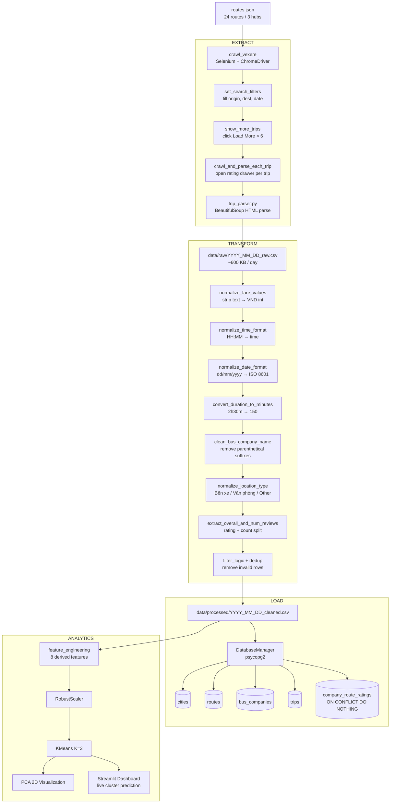
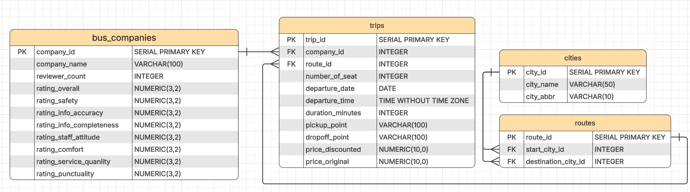
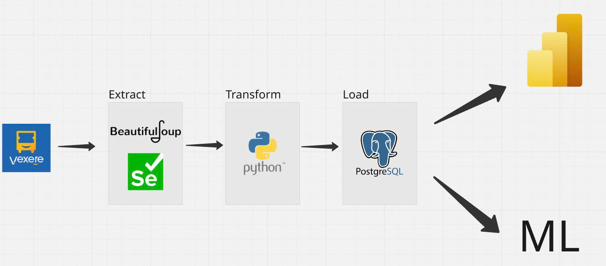

# 🚍 Vexere Bus Trip Analytics — ETL Pipeline & ML Clustering

> **End-to-end data pipeline** that automatically crawls intercity bus trip data from [Vexere.com](https://vexere.com), cleans and loads it into PostgreSQL, then applies KMeans clustering to segment trips by price tier and service quality — served through an interactive Streamlit dashboard.

[](https://www.python.org/)
[](https://selenium.dev/)
[](https://pandas.pydata.org/)
[](https://scikit-learn.org/)
[](https://www.postgresql.org/)
[](https://streamlit.io/)
[](https://powerbi.microsoft.com/)
[](./docs/)

---

## 📌 Problem Statement

The Vietnamese intercity bus market aggregated on Vexere.com contains hundreds of trips per day across thousands of routes — yet there is no structured, time-series dataset available for comparative price and service analysis.

This project solves that gap by building a fully automated pipeline that:
1. **Collects** daily trip listings including fare, ratings, schedule, and operator details across **24 routes from 3 major departure hubs**.
2. **Normalises** the raw HTML-extracted data into a clean, analytics-ready schema.
3. **Segments** trips into interpretable clusters using unsupervised machine learning, enabling data-driven recommendations for passengers and market insights for operators.

---

## 🎯 Key Features

- **Headless browser automation** — Selenium + `webdriver-manager` drives Chrome to render JS-heavy pages, auto-clicks "Load More" (up to 6 times) and expands per-trip rating drawers before parsing.
- **Multi-route batch crawl** — Configurable `routes.json` covers 3 departure hubs × 8 destinations each (24 routes). All routes are crawled sequentially with rate-limiting to avoid bans.
- **Structured HTML parsing** — BeautifulSoup extracts fare (regular & discounted), schedule, pickup/dropoff type, operator name, overall rating, and 7 granular sub-ratings per trip.
- **Layered transformation pipeline** — Dedicated cleaners per concern: price normalisation, time/date parsing, duration conversion, location type standardisation, bus company name deduplication, and rating renaming.
- **Upsert-safe PostgreSQL loading** — `DatabaseManager` implements `get_or_insert` patterns for cities, routes, and companies, plus `ON CONFLICT DO NOTHING` for daily rating snapshots — idempotent by design.
- **Feature engineering for clustering** — 8 engineered features derived from raw fields: `wilson_score`, `log_price`, `service_score`, `trust_score`, `fairness_index`, `price_rating_ratio_stable`, `discount_rate`, `real_price`.
- **KMeans clustering (K=3) with RobustScaler** — Outlier-resistant scaling followed by KMeans (n_init=10, random_state=40), visualised with PCA 2D projection.
- **Interactive Streamlit app** — Live cluster prediction: enter any trip's price and ratings to see which segment it falls into, with plain-language segment explanations.
- **Power BI dashboard** — Pre-built `.pbix` report for executive-level visualisation of pricing trends and operator comparisons.

---

## 🏗️ System Architecture

### Data Flow



### Database Schema

```
┌─────────────┐        ┌──────────────┐        ┌─────────────────────────┐
│   cities    │        │    routes    │        │  company_route_ratings  │
│─────────────│        │──────────────│        │─────────────────────────│
│ city_id  PK │◄──────►│ route_id  PK │◄──────►│ id               PK     │
│ city_name   │        │ start_city_id│        │ company_id  FK          │
└─────────────┘        │ dest_city_id │        │ route_id    FK          │
                       └──────┬───────┘        │ crawl_date              │
                              │                │ reviewer_count          │
                       ┌──────▼───────┐        │ rating_overall          │
                       │    trips     │        │ rating_safety           │
                       │──────────────│        │ rating_info_accuracy    │
                       │ trip_id   PK │        │ rating_staff_attitude   │
                       │ company_id FK│        │ rating_comfort          │
                       │ route_id  FK │        │ rating_service_quality  │
                       │ departure_*  │        │ rating_punctuality      │
                       │ arrival_time │        └─────────────────────────┘
                       │ price_orig   │
                       │ price_disc   │        ┌─────────────────┐
                       │ number_of_   │        │  bus_companies  │
                       │   seat       │        │─────────────────│
                       │ duration_min │        │ company_id   PK │
                       │ pickup_point │◄───────│ company_name    │
                       └──────────────┘        └─────────────────┘
```



---

## 🛠️ Tech Stack

| Category | Technology | Version / Notes |
|---|---|---|
| **Language** | Python | 3.10+ |
| **Web Scraping** | Selenium | 4.x — headless Chrome automation |
| | BeautifulSoup4 | 4.12.3 — HTML parsing |
| | webdriver-manager | Auto ChromeDriver management |
| **Data Processing** | Pandas | 2.1.4 — ETL & feature engineering |
| | NumPy | 1.26.4 — numerical ops |
| **Machine Learning** | scikit-learn | 1.3.2 — KMeans, RobustScaler, PCA |
| | SciPy | 1.11.4 — Wilson score interval |
| **Database** | PostgreSQL | 12+ — 5-table normalised schema |
| | psycopg2 | Python ↔ PostgreSQL adapter |
| **Visualisation** | Streamlit | Interactive ML dashboard |
| | Matplotlib | PCA cluster scatter plots |
| | Power BI | `.pbix` executive report |
| **Notebooks** | Jupyter | EDA + ML modelling notebooks |

---

## 📁 Project Structure

```
vexere-analysis/
│
├── main.py                          # Pipeline entry point (crawl → clean → load)
├── routes.json                      # Crawl targets: 3 hubs × 8 destinations
├── requirements.txt                 # Pinned Python dependencies
│
├── demo/
│   └── app.py                       # Streamlit clustering dashboard
│
├── src/
│   ├── extract/                     # EXTRACT layer
│   │   ├── crawling.py              #   Orchestrates crawl for one route
│   │   ├── trip_actions.py          #   Selenium page interactions
│   │   └── trip_parser.py           #   BeautifulSoup HTML → DataFrame
│   │
│   ├── transform/
│   │   └── cleaning/                # TRANSFORM layer (one file per concern)
│   │       ├── cleaning.py          #   Pipeline orchestrator
│   │       ├── schedule_price_cleaner.py  # Fare, time, date, duration
│   │       ├── rating_cleaner.py    #   Rating split, rename, fill
│   │       ├── bus_info_cleaner.py  #   Seat count, company name
│   │       └── location_cleaner.py  #   Pickup/dropoff type normalisation
│   │
│   ├── load/
│   │   └── loading.py               # LOAD layer: DataFrame → PostgreSQL
│   │
│   ├── database/
│   │   ├── db_manager.py            # DatabaseManager (psycopg2 wrapper)
│   │   
│   │
│   ├── sql/
│   │   └── schema.sql               # DDL for all 5 tables
│   │
│   ├── ml/
│   │   └── modeling.ipynb           # KMeans experimentation notebook
│   │
│   └── utils/
│       ├── file_utils.py            # CSV I/O + routes.json loader
│       ├── selenium_utils.py        # Driver factory + wait/click helpers
│       └── log_utils.py             # Timestamped logging
│
├── data/
│   ├── raw/                         # Raw CSVs: 2025_11_XX_raw.csv (~600 KB/day)
│   ├── processed/                   # Cleaned CSVs: 2025_11_XX_cleaned.csv
│   └── site/                        # Sample HTML snapshots for debugging
│
├── notebooks/
│   └── EDA.ipynb                    # Exploratory Data Analysis
│
├── docs/
│   ├── Report - Ứng dụng học máy...pdf   # Full technical report
│   └── Slide - Ứng dụng học máy...pdf    # Presentation deck
│
├── assets/
│   └── readme_img/                  # Images used in documentation
│
└── data visualization.pbix          # Power BI dashboard
```

---

## ⚙️ Getting Started

### Prerequisites

| Requirement | Version |
|---|---|
| Python | 3.10+ |
| PostgreSQL | 12+ |
| Google Chrome | Latest stable |
| ChromeDriver | Auto-managed via `webdriver-manager` |

### 1 — Clone the repository

```bash
git clone https://github.com/<your-username>/ds-vexere-analysis.git
cd ds-vexere-analysis
```

### 2 — Create and activate a virtual environment

```bash
python -m venv .venv
source .venv/bin/activate        # Linux / macOS
# .venv\Scripts\activate         # Windows
```

### 3 — Install dependencies

```bash
pip install -r requirements.txt

# Dependencies NOT in requirements.txt (inferred from imports):
pip install selenium webdriver-manager psycopg2-binary streamlit matplotlib
```

> **Note:** `webdriver-manager` will automatically download the correct ChromeDriver for your installed Chrome version on the first run — no manual ChromeDriver setup needed.

### 4 — Set up the database

```sql
-- Connect to PostgreSQL and create the database
CREATE DATABASE vexere_db;
```

```bash
# Run the DDL schema
psql -U postgres -d vexere_db -f src/sql/schema.sql
```

### 5 — Configure database credentials

Edit `src/database/config.json` with your PostgreSQL credentials:

```json
{
  "DB_CONNECTION": {
    "HOST": "localhost",
    "PORT": 5432,
    "DATABASE": "vexere_db",
    "USER": "your_username",
    "PASSWORD": "your_password"
  }
}
```

> ⚠️ **Security note:** `config.json` contains plaintext credentials. Add it to `.gitignore` before committing to a public repository.

### 6 — Configure crawl routes (optional)

`routes.json` defines which routes to crawl. The default covers 24 routes:

```json
{
  "routes": [
    {
      "from_city": "Sài Gòn",
      "to_cities": ["Đà Lạt", "Nha Trang", "Bà Rịa-Vũng Tàu", "..."]
    },
    {
      "from_city": "Hà Nội",
      "to_cities": ["Hải Phòng", "Hà Giang", "SaPa", "..."]
    }
  ]
}
```

### 7 — Run the ETL pipeline

```bash
python main.py
```

The pipeline executes three sequential steps:

| Step | Action | Output |
|---|---|---|
| **CRAWL** | Opens Chrome, fills search form, clicks Load More, extracts all trip cards + rating drawers | `data/raw/YYYY_MM_DD_raw.csv` |
| **CLEAN** | Normalises fares, times, ratings; removes duplicates and invalid rows | `data/processed/YYYY_MM_DD_cleaned.csv` |
| **LOAD** | Upserts cities/routes/companies, inserts trips + daily rating snapshots | PostgreSQL tables |

**Configurable parameters in `main.py`:**

```python
DAYSOFF = 2   # Crawl trips departing N days from today (default: 2)
```

### 8 — Launch the Streamlit dashboard

```bash
streamlit run demo/app.py
```

Open your browser at **`http://localhost:8501`**

---

## 📊 Results & Output

### Cluster Segments (KMeans, K=3)

| Cluster | Label | Characteristics |
|---|---|---|
| **0** | Affordable & Reliable | Mid-range price · Consistent service · Good Wilson score |
| **1** | Overpriced & Underdelivering | Above-average fare · Below-average satisfaction · Low Wilson score |
| **2** | Premium & Worth It | High price · High satisfaction · Strong trust & service scores |

### Engineered Features Used for Clustering

| Feature | Formula | Purpose |
|---|---|---|
| `real_price` | `price_discounted` if discounted else `price_original` | Effective fare paid |
| `log_price` | `log(real_price + 1)` | Log-normalised price |
| `discount_rate` | `1 − discounted / original` | Discount depth |
| `service_score` | `mean(staff_attitude, service_quality, comfort)` | Service experience score |
| `trust_score` | `mean(safety, punctuality, info_accuracy)` | Operational reliability score |
| `wilson_score` | Wilson lower confidence bound @ 95% | Review-count-adjusted rating |
| `price_rating_ratio_stable` | `wilson_score / log_price` | Value-for-money ratio |
| `fairness_index` | `wilson_score / √real_price` | Price–quality fairness |

### Dataset Scale

| Metric | Value |
|---|---|
| Coverage period | Nov 12 – Nov 23, 2025 (12 days) |
| Routes crawled | 24 (3 departure hubs × 8 destinations) |
| Raw file size | ~600 KB / day |
| Departure hubs | Sài Gòn, Hà Nội, Đà Nẵng |

### Pipeline Diagram



---

## 📓 Notebooks & Reports

| File | Description |
|---|---|
| `notebooks/EDA.ipynb` | Exploratory data analysis — distributions, correlations, outlier detection |
| `src/ml/modeling.ipynb` | KMeans hyperparameter tuning, elbow method, PCA visualisation |
| `data visualization.pbix` | Power BI dashboard — pricing trends, operator comparison, route analysis |
| `docs/Report - ...pdf` | Full academic report on methodology and findings |
| `docs/Slide - ...pdf` | Presentation deck (Vietnamese) |


---

## 👤 Author

**An Le**

[](https://github.com/Le-AnV)
[](https://www.linkedin.com/in/van-an-le-87b267371/)
